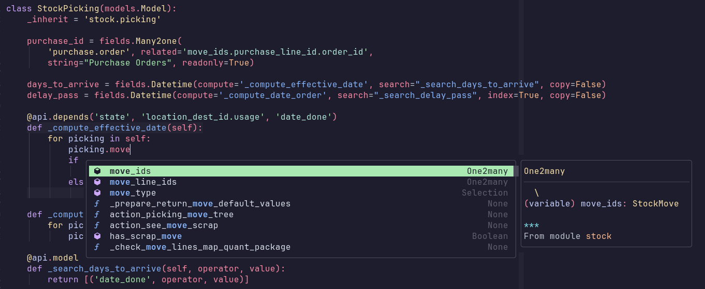
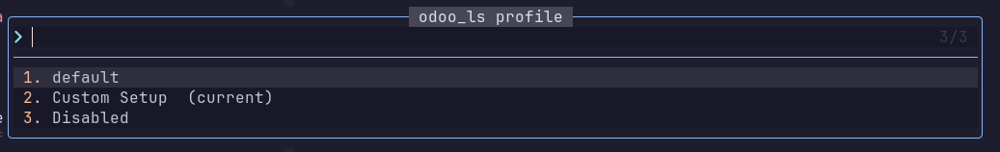
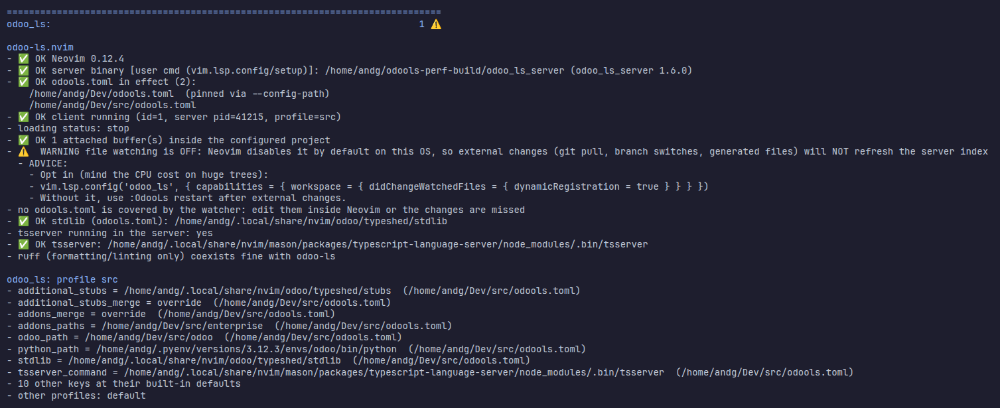

# odoo-neovim

A Neovim client for the [odoo-ls](https://github.com/odoo/odoo-ls) language
server. It launches the binary, answers the server's configuration request and
handles its `$Odoo/*` notifications. The real configuration lives in
`odools.toml`, read by the server, and the client adds no keymaps or UI of its
own.

Inside Neovim, the full reference is `:help odoo_ls`.



## Requirements

- Neovim **0.11.2+**.
- `curl`, `tar` and `unzip` on your `PATH` for the managed server install, or
  your own `odoo_ls_server` binary.

## Install

With [lazy.nvim](https://github.com/folke/lazy.nvim):

```lua
{
  'odoo/odoo-neovim',
  ft = { 'python', 'xml', 'csv', 'javascript', 'typescript' },
  cmd = 'OdooLs',
  config = function()
    require('odoo_ls').setup()
  end,
}
```

`setup()` downloads the server and its typeshed stubs into
`stdpath('data')/odoo/<tag>/` and enables the client. Each plugin version
installs the odoo-ls release with the same number, so updating the plugin
updates the server. To run another server release, pin or switch the plugin
itself (a `tag` or `branch` in your plugin manager).

Options (all optional):

```lua
require('odoo_ls').setup({
  profile = 'default',  -- odools.toml profile to select
  cmd = nil,            -- your own launch command, never replaced by an install
})
```

`setup()` is optional: a plain `vim.lsp.enable('odoo_ls')` uses the
`lsp/odoo_ls.lua` spec as is, never downloads anything, and finds the server on
your `PATH` or through `:OdooLs install`.

The `alpha` odoo-ls branch has no published builds. Build it with
`cargo install --git https://github.com/odoo/odoo-ls --branch alpha odoo_ls_server`
and pass it as `cmd`, with typeshed set through `stdlib` in `odools.toml`.

## Configuration

The client attaches only to files under an `odools.toml`, and that file's
directory becomes the workspace folder. Put it in the directory that holds both
odoo and enterprise. Each profile is a `[[config]]` table:

```toml
#:schema https://github.com/odoo/odoo-ls/releases/download/1.6.1/config_schema.json

[[config]]
name = "default"
odoo_path = "/home/user/src/odoo"
addons_paths = ["/home/user/src/enterprise"]
python_path = "/home/user/.pyenv/shims/python"
```

See the [odoo-ls repository](https://github.com/odoo/odoo-ls) for every key.
The client only chooses the profile (`"default"` unless set, `"Disabled"` makes
the server idle) and the launch command, also settable the standard way:

```lua
vim.lsp.config('odoo_ls', {
  cmd = { '/abs/path/to/odoo_ls_server' },
  settings = { Odoo = { selectedProfile = 'My Setup' } },
})
```

## Commands

| Command           | Action                                                     |
| ----------------- | ---------------------------------------------------------- |
| `:OdooLs health`  | Run `:checkhealth odoo_ls` (default when run bare).        |
| `:OdooLs profile` | Pick a profile via `vim.ui.select` and restart the server. |
| `:OdooLs restart` | Restart the server, re-attaching current buffers.          |
| `:OdooLs logs`    | Open the newest server log file.                           |
| `:OdooLs install` | Download the server release matching the plugin version.   |



## Health

`:checkhealth odoo_ls` is the first stop when something looks wrong. It reports
which binary runs and whether its version matches the plugin, which
`odools.toml` files the server uses and the keys they set, buffers outside the
workspace, typeshed, file watching, `tsserver`, overlapping Python servers, and
every config and server diagnostic.



## Known limitations

- **File watching is off on Linux.** Neovim disables it there by default, so a
  `git pull` or branch switch is not seen by the server. Run `:OdooLs restart`,
  or see `:help odoo_ls-limitations` to opt in.
- **`odools.toml` is not watched.** Edits made outside Neovim need a restart.
- **Position encoding is utf-16 only**, so the client can share buffers with
  lemminx and other utf-16 servers.

## Versioning

Versions follow the odoo-ls server: each server release gets a plugin release
with the same number, even when the client is unchanged. Changes are listed in
[CHANGELOG.md](CHANGELOG.md).

### Upgrading from the old snippet config

1.6.1 changes defaults the snippet relied on: the selected profile is now
`default` (was `main`), the client attaches only under an `odools.toml`, and
that file must hold its keys in a `[[config]]` table. The client points out the
first and the last when it meets them. See the Breaking section of the
[CHANGELOG](CHANGELOG.md).

## License

LGPL-3.0, the same as the language server.
